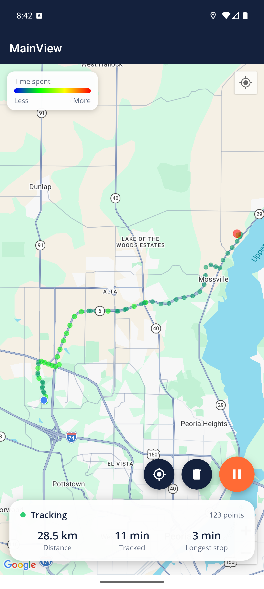

# Heat Map Tracker

A .NET MAUI app that tracks your location, saves every reading to a local SQLite database, and shows where you have been as a **heat map**. The heat map is built by extending the .NET MAUI Maps control. Places where you spend more time glow hotter, from blue through green and yellow to red.

MSCS-533 Software Engineering for Multiplatform App Development: Final Project.

<p align="center">
  
</p>

## Try it (no build needed)

A ready-to-install Android APK, with the map already configured, is attached to the latest release:

**[Download HeatMapTracker.apk from Releases](https://github.com/Sarathyponnapalli/SW-Eng-Multiplatform-App-Dev-MSCS-533-A01/releases/latest)**

1. Start an Android emulator (Android 5.0 / API 21 or later, with a **Google APIs** or **Google Play** image so Google Maps works), or use an Android phone.
2. **Emulator:** drag the `.apk` file onto the emulator window. **Phone:** open the file and allow installing from this source.
3. Open **Heat Map Tracker** and tap **Allow** for location.
4. To see the heat map build, open the emulator's **⋯ Extended controls → Location → Routes**, play a route, and let it sit at the end for a minute.

## Features

- **Location tracking**: records your position every 5 seconds while the app is open. Inaccurate readings (worse than 50 m) are discarded.
- **SQLite persistence**: every reading is saved on the device, and your heat map is restored when the app restarts.
- **Heat map on .NET MAUI Maps**: the `HeatMap` control subclasses the MAUI `Map` and adds a weighted heat-map layer.
  - Nearby readings are grouped into grid cells. Each cell is drawn as a translucent circle whose color and size grow with the time spent there.
  - Intensity is log-scaled and compared against the cells **on screen**, so the hottest visible place is always red.
  - Cell size and circle radius scale with zoom, so the heat stays readable from street level to city level.
- **Stats card**: live tracking status, total distance, time tracked and longest stop. Session gaps, GPS jitter and impossible jumps are ignored.
- **Controls**: start/pause tracking, zoom to fit your whole history, and delete history (with confirmation).
- **Branded UI**: navy and heat-orange theme, a custom app icon and splash screen, and a heat legend.

## How the heat map works

```
GPS reading ──► LocationTracker ──► SQLite (location_points)
                                          │
                                          ▼
                 HeatmapBuilder: bin readings into ~25 m grid cells (larger when zoomed out)
                                          │  count per cell = time spent there
                                          ▼
                 intensity = log(1 + count) / log(1 + busiest visible count)
                                          │
                                          ▼
                 HeatGradient: intensity ──► color (blue→green→yellow→red) + radius
                                          │
                                          ▼
                 HeatMap control: one Circle map element per cell
```

Readings are sampled by **time**, not by distance moved, so standing in one place keeps adding readings to the same cell. That is what makes the places you linger turn red.

## Architecture

| Project | Purpose |
|---|---|
| `src/HeatMapTracker.Core` | Platform-independent logic (`net10.0`): the `LocationPoint` model, the SQLite repository, heat-map aggregation and color gradient, and trip statistics. |
| `src/HeatMapTracker` | The .NET MAUI app (MVVM with CommunityToolkit.Mvvm and dependency injection): the `HeatMap` control, `LocationTracker` service, `MainViewModel` and `MainView`. |
| `tests/HeatMapTracker.Core.Tests` | 42 xUnit tests for the Core library, including persistence across a database reopen. |

The logic lives in a separate library so it can be unit-tested without a device. The app layer only connects it to the UI and device APIs.

Key files:

- [`Controls/HeatMap.cs`](src/HeatMapTracker/Controls/HeatMap.cs): the extended Maps control.
- [`Services/LocationTracker.cs`](src/HeatMapTracker/Services/LocationTracker.cs): foreground location sampling.
- [`Data/SqliteLocationRepository.cs`](src/HeatMapTracker.Core/Data/SqliteLocationRepository.cs): SQLite storage.
- [`Heatmap/HeatmapBuilder.cs`](src/HeatMapTracker.Core/Heatmap/HeatmapBuilder.cs): grid aggregation.
- [`Platforms/Android/AndroidManifest.xml`](src/HeatMapTracker/Platforms/Android/AndroidManifest.xml): permissions and the Maps key placeholder.

## Getting started

### Prerequisites

- Visual Studio 2022/2026 with the **.NET Multi-platform App UI** workload, or the .NET 10 SDK with the `maui` workload.
- An Android emulator (Google APIs or Google Play image) or an Android device.
- A **Google Maps SDK for Android** API key.

### 1. Add your Maps API key (never commit it)

The key is supplied at build time and is **not** stored in source control:

1. Copy `src/HeatMapTracker/secrets.props.example` to `src/HeatMapTracker/secrets.props`. This file is git-ignored.
2. Replace `YOUR_ANDROID_MAPS_KEY` with your key.
3. In Google Cloud Console, restrict the key to **Android apps** (package `com.mscs533.heatmaptracker` and your signing SHA-1) and to the **Maps SDK for Android** API.

At build time MSBuild substitutes the key into `${mapsApiKey}` in the Android manifest. CI can set the `MAPS_API_KEY` environment variable instead. If no key is set, the build prints a warning and the map renders blank.

### 2. Build and run

```bash
# Run the unit tests
dotnet test tests/HeatMapTracker.Core.Tests

# Build, install and launch on a running emulator or device
dotnet build src/HeatMapTracker/HeatMapTracker.csproj -f net10.0-android -t:Run
```

Or open `HeatMapTracker.slnx` in Visual Studio, choose the Android emulator, and press **F5**.

### 3. Simulate a trip in the emulator

In the emulator, open **⋯ Extended controls → Location → Routes**. Search for a start and a destination, save the route, and **Play route** (4–5x speed works well). Leave it at the destination for a couple of minutes to build a hot spot, then tap **Show whole history**.

## Privacy

- Location is only collected while the app is open. There is no background tracking.
- History stays on the device: it is not uploaded, and Android backup is disabled (`allowBackup="false"`).
- **Delete** permanently removes all saved locations.

## Platforms

Android is the tested target. The project also targets iOS, but building for iOS requires a Mac. The .NET MAUI Maps control does not support Windows.
